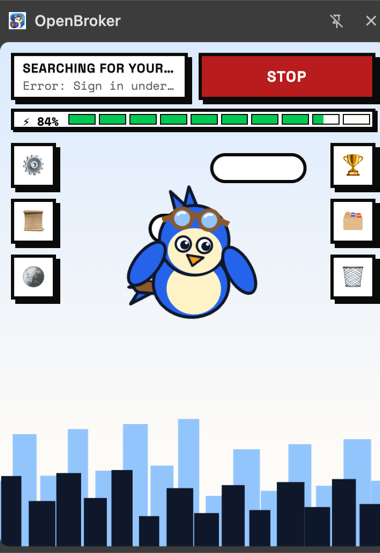

<p align="center">
  
</p>

<h1 align="center">Koo</h1>

<p align="center">
  <b>An AI agent in your browser that hunts for flats in Facebook groups for you.</b><br>
  Open a group, press <b>Start</b>. Koo reads every post and lists only the flats that match your search.
</p>

<table>
  <tr>
    <td width="40%" valign="top"></td>
    <td valign="top">

### What it does

| | |
|---|---|
| 📜 **Reads posts for you** | Scrolls the group at a human pace, expands "See more", strips Facebook's hidden junk text |
| 🔁 **Never twice** | Remembers posts it has read (30 days), so later runs only see new ones |
| 🤖 **AI judges each flat** | Budget, size range, location & distance, amenities, gender, all in one AI call per batch |
| 🏆 **Matches with contacts** | Rent, deposit, BHK, distance, society, phone numbers with country code |
| ↕️ **Sort & export** | Order by rent, deposit, amenities (multi-column); export all or only new to Excel (CSV) |
| 🔑 **Your key or credits** | Use your own OpenAI / Gemini / Anthropic key, **or** 🪙 Koo credits paid by UPI |
| ✏️ **Your rules** | Edit the AI instructions yourself; the default is built in |

</td>
  </tr>
</table>

---

## 🚀 Use it yourself (no coding needed)

The extension is already built in **`output/chrome-mv3/`**. You only need Google Chrome.

| Step | Do this |
|:-:|---|
| **1** | **Download:** on GitHub click **Code → Download ZIP** and unzip it, or `git clone` the repo |
| **2** | Open **`chrome://extensions`** in the address bar |
| **3** | Turn on **Developer mode** (top-right switch). It only allows installing from a folder |
| **4** | Click **Load unpacked** and select the **`output/chrome-mv3`** folder (the one with `manifest.json`) |
| **5** | Click the 🧩 puzzle icon and **pin Koo** |
| **6** | Open the panel and go to **⚙️ Search settings**: choose how the AI is paid for and fill in what you want |
| **7** | Open a Facebook flat-rental group (logged in) and press **Start**. Matches appear under **🏆** |

| To… | Do this |
|---|---|
| **Update** | Download again (or `git pull`), then press ↻ on Koo's card in `chrome://extensions`. Your data is kept |
| **Remove** | Press **Remove** on its card. This also deletes its stored data, including your API key |

---

## 🧭 The panel

| Button | Opens |
|:-:|---|
| ⚙️ | **Search settings**: location & max distance, budget, size, amenities, gender, batch size, AI provider, AI instructions |
| 📜 | **Activity log**: every step the agent took |
| 🪙 | **Koo credits**: sign in, balance, buy packs by UPI |
| 🏆 | **Matches**: sort chips, CSV export, cart-style items with rent on the right and contacts at the bottom |
| 🗂️ | **All decisions**: every post the AI checked, with its reason |
| 🗑️ | **Clear history**: click twice; forgets read posts, decisions and the log |

### Search filters

| Filter | How the AI uses it |
|---|---|
| **Target location + max distance** | Estimates the distance from the post's area to yours; farther = not a match |
| **Budget** | Rent above it = not a match; shows how far over or under (`+₹2,000` / `−₹4,000`) |
| **Size** | A range: `2-3 BHK` means 2 ≤ size < 4, so 2, 2.5, 3 and 3.5 BHK pass |
| **Amenities** | Scored 0–100% for sorting |
| **Your gender** | Skips posts limited to another gender ("girls only", "male replacement") |

---

## 🐦 Meet Koo

<table>
  <tr>
    <td width="180"></td>
    <td>Koo is the explorer bird who shows what the agent is doing, and how tired it's getting. Goggles for exploring,
    and a backpack with a little house for the home it's finding you.</td>
  </tr>
</table>

| | State | Scene | When |
|:-:|---|---|---|
|  | ✈️ **Searching** | Flying over the city | Reading posts |
|  | 🎉 **Dancing** | Mid-air, music notes | A batch had a match (2 s) |
|  | 😤 **Irritated** | Still flying, 💢 | Energy 25–50% (it keeps searching) |
|  | 💧 **Water break** · ⚡ **Energy drink** | Riverbank, with a countdown | Water at 90, 80 … 30% energy (5 s, +4%) · energy drink at 25% (15 s, back to 75%) |
|  | 😴 **Sleeping** | Night, tree branch | Stopped (energy resets to 100%) |

Energy drains **1% per second** while searching, and a match adds **+2%**. Scanning pauses during breaks. Every move
between scenes is animated: take-off, landing, and flying down to the river.

---

## 🔑 Paying for the AI

| | Your own API key | 🪙 Koo credits |
|---|---|---|
| **You need** | An OpenAI, Google Gemini or Anthropic key | A Google account and UPI |
| **Set up in** | ⚙️ Search settings → Provider | ⚙️ Provider = Koo credits, then 🪙 Sign in |
| **Your key goes to** | Only that provider (stored on your computer, unencrypted) | Not needed; Koo's key is used |
| **Cost** | Billed by your provider | **1 🪙 = ₹1.** Packs: ₹100 → 100 🪙 · ₹200 → 200 🪙 · ₹500 → 500 🪙 (minimum ₹100) |

> **Local mode:** while no central Koo API is deployed, Koo credits use a local one at `localhost:8787`, with
> no sign-in and no credits. See **Running the cloud API → Local mode** below.

---

## 🛠️ Development

> Requires Node.js 22+ and Google Chrome.

| Command | What it does |
|---|---|
| `npm install` | Install dependencies |
| `npm run build` | Production build → `output/chrome-mv3` **(commit it after changes, so downloads stay current)** |
| `npm run dev` | Live-reload build → load `output/chrome-mv3-dev` (needs the dev server running; not committed) |
| `npm test` | Unit tests for `lib/` and `cloud/` (Node's built-in runner) |
| `npm run cloud:dev` | Run the cloud API locally (Wrangler) |
| `npm run cloud:deploy` | Deploy the cloud API to Cloudflare |
| `npm run cloud:db` | Create the D1 tables (remote) |

| Path | What's in it |
|---|---|
| `entrypoints/content.ts` | Facebook scanner: scroll, read, dedupe, batch, energy & breaks. **Page selectors are in `SEL` at the top** |
| `entrypoints/background.ts` | Receives batches, calls the AI (your key or the cloud API), stores decisions |
| `entrypoints/sidepanel/` | Panel UI (React) and Koo (`koo.tsx`) |
| `lib/classify.ts` | Prompt, AI provider calls, post IDs, text cleanup, phone numbers & country codes |
| `lib/energy.ts` · `sort.ts` · `csv.ts` | Koo's energy model · match ordering · CSV export |
| `cloud/worker.ts` | Cloud API: sign-in, credits, UPI checkout, webhook, paid AI calls |
| `cloud/billing.ts` · `schema.sql` | Packs, cost, webhook signature, exactly-once crediting (tested) · D1 tables |
| `wxt.config.ts` | Manifest and build config (the fixed extension `key` lives here) |

Chrome 137+ no longer lets tools auto-load extensions, so loading is always manual. Icons are in `public/icon/`.

---

## ☁️ Running the cloud API (operators)

<details>
<summary><b>How Koo credits work</b> (Cloudflare Worker + D1, Razorpay UPI, Google sign-in)</summary>

<br>

```text
Panel ──sign in (Google)──► /auth      → Koo token (only its hash is stored)
Panel ──buy ₹200─────────► /checkout  → UPI-only Razorpay Payment Link (user id attached)
User pays by UPI ────────► Razorpay ──► /razorpay-webhook → signature check → +100 🪙, exactly once
Scanner ─batch of posts──► /classify  → checks credits → AI with your key → deducts the real token cost
```

| Endpoint | Purpose |
|---|---|
| `POST /auth` | Google access token → Koo token |
| `GET /me` | Email and credit balance |
| `POST /checkout` | UPI-only Razorpay Payment Link for a ₹100 / ₹200 / ₹500 pack |
| `POST /razorpay-webhook` | Verifies Razorpay's signature and credits the payment exactly once |
| `POST /classify` | Refuses at 0 credits; failed AI calls cost nothing |

1 credit = ₹1 paid, minimum top-up ₹100. Each AI call is charged at **2× the provider's real cost** (`MARKUP` in
`cloud/billing.ts`), which is your margin. Razorpay takes about 2% + GST per payment (check their pricing page) out of it.

</details>

<details>
<summary><b>One-time setup</b></summary>

<br>

| # | Where | What |
|:-:|---|---|
| 1 | **Cloudflare** | `npx wrangler login` → `npx wrangler d1 create koo` → paste `database_id` into `cloud/wrangler.toml` → `npm run cloud:db` |
| 2 | **Prices** | In `cloud/wrangler.toml` set `LLM_PROVIDER`, `LLM_MODEL`, `PRICE_INPUT_INR_PER_1M`, `PRICE_OUTPUT_INR_PER_1M` (calls are refused while prices are 0) |
| 3 | **Secrets** | `npx wrangler secret put <NAME> --config cloud/wrangler.toml` for `LLM_API_KEY`, `RZP_KEY_ID`, `RZP_KEY_SECRET`, `RZP_WEBHOOK_SECRET` |
| 4 | **Deploy** | `npm run cloud:deploy` → note `https://koo.<you>.workers.dev` |
| 5 | **Razorpay** | Webhook `https://<worker>/razorpay-webhook`, event **`payment_link.paid`**, same secret as `RZP_WEBHOOK_SECRET` (test keys first) |
| 6 | **Google** | OAuth client of type **Chrome Extension**, item ID **`ickjoonhepcjfhdiopbckhgalfdgijbj`** |
| 7 | **Build** | `.env` with `WXT_API_URL=…` and `WXT_GOOGLE_CLIENT_ID=…` → `npm run build` → commit `output/chrome-mv3/` |
| 8 | **AI balance** | Turn on auto-recharge in your AI provider's billing settings |

</details>

<details>
<summary><b>Local mode and local testing</b></summary>

<br>

Built without `WXT_API_URL`, the extension's Koo credits use `http://localhost:8787` with **no sign-in and no credits**:

```bash
# cloud/.dev.vars (git-ignored)
LLM_API_KEY=sk-...   # your own provider key
DEV_NO_AUTH=1        # honoured only for requests to localhost, never by a deployed worker
```

Then run `npm run cloud:dev`, choose **🪙 Koo credits** and press Start.

To test the full paid flow locally, add the Razorpay secrets to `cloud/.dev.vars`, create the local tables with
`npx wrangler d1 execute koo --local --file cloud/schema.sql --config cloud/wrangler.toml`, then run `npm run cloud:dev`.

</details>

---

## ⚠️ Good to know

| | |
|---|---|
| **Facebook's terms** | Automated browsing is against them. Koo only reads, runs only when you press Start, in a tab you can see, at a human pace. Use it on your own account at your own risk |
| **Messaging** | Not automated. Contacts are collected so you can reach out yourself |
| **Facebook changes** | If posts stop being found, the selectors in `SEL` (`entrypoints/content.ts`) need updating |
